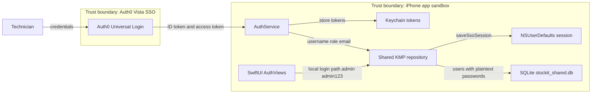
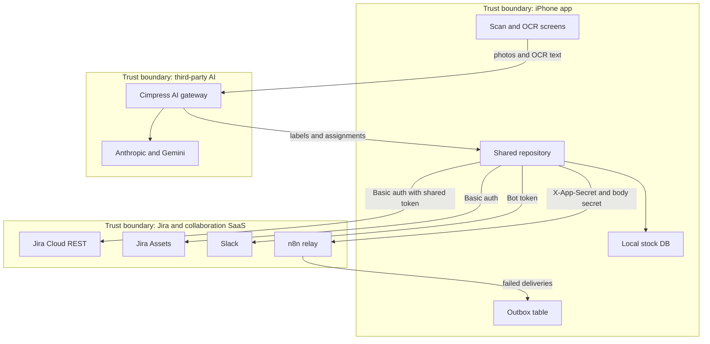
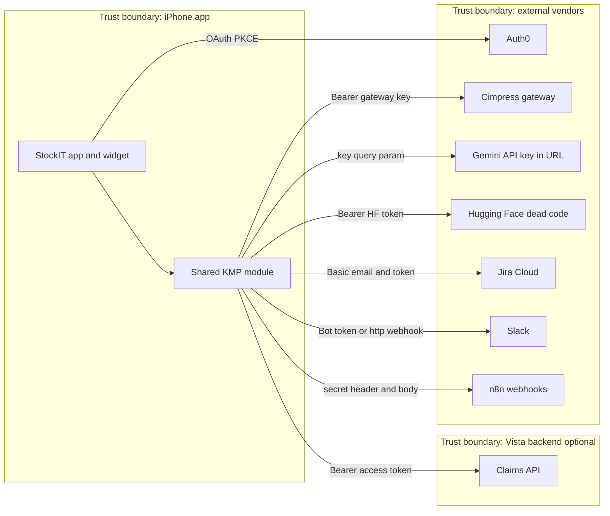
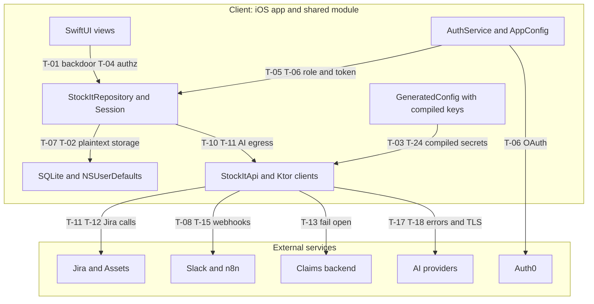
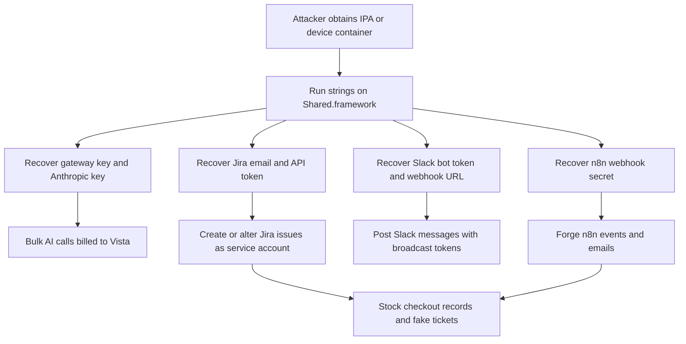
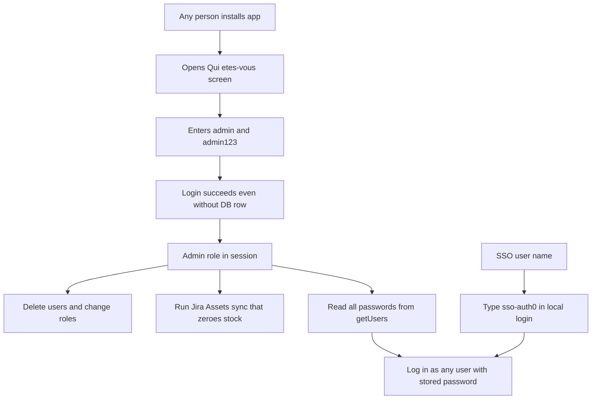
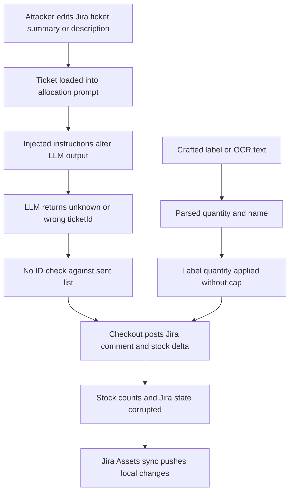
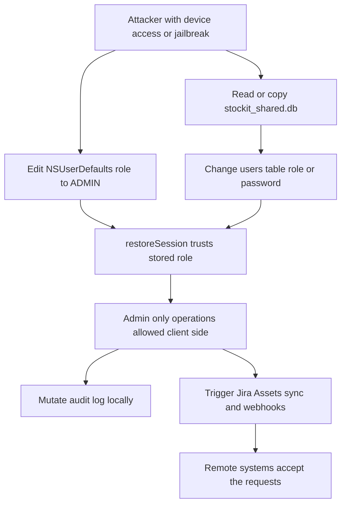

# StockIT iOS - Threat Model

**Date:** 2026-10-28
**Scope:** StockIT iOS application (`iosApp/`, SwiftUI, widget extension) and the Kotlin Multiplatform `shared` module (`shared/`, compiled to `Shared.framework`), including all outbound integrations (Auth0, Cimpress AI gateway, Anthropic, Gemini, Hugging Face, Jira Cloud, Jira Assets, Slack, n8n, optional claims backend). Build tooling (Gradle, XcodeGen `project.yml`) is in scope for supply-chain analysis.
**Out of scope:** Auth0 tenant and Okta configuration, Jira/Slack/n8n server-side configuration, Cimpress gateway internals, physical device security beyond iOS platform controls.
**Methodology:** STRIDE per data flow and per trust boundary, split into (A) domain-specific threats (mobile app, KMP client, integrations) and (B) domain-agnostic threats (supply chain, secrets management, third-party data egress). Each threat is assessed against existing controls. Threats with no effective control are flagged as Critical or as requiring immediate attention.
**Path shorthand:** `S/` = `shared/src/commonMain/kotlin/com/example/stockit/shared/`. `I/` = `iosApp/StockIT/`. Line numbers were verified against the working tree on 2026-10-28.

---

## Executive Summary

StockIT is an internal inventory tool used by Vista ETX technicians. The client is "thick": business rules, authorization, persistence, and most integration credentials live on the device. This model finds **4 Critical, 9 High, 12 Medium, 5 Low** threats across 30 entries. Most Critical and High findings are uncontrolled: the app has no server-side enforcement that the client cannot bypass.

**Top 5 risks**

1. **Hardcoded administrator backdoor (T-01).** `admin` / `admin123` is accepted with no database row, and is seeded into the production database. The app also calls this login on every profile load in all build configurations.
2. **Secrets compiled into the binary (T-03, T-24).** Roughly 40 configuration keys, including the AI gateway key, Jira API token, Slack bot token, and the n8n webhook secret, are emitted as `const val` strings and are recoverable with `strings`.
3. **Client-side-only authorization (T-04).** Role checks are local. Any user with a modified local database or a `role` value in NSUserDefaults can run admin-level operations, and a restored session trusts the stored role.
4. **Plaintext credentials and customer PII on device (T-02, T-07).** Passwords are stored in plaintext, SSO users get the literal password `sso-auth0`, and the SQLite database and session data are unencrypted.
5. **Destructive, unscoped writes driven by any user or by AI output (T-09, T-10).** Any user can trigger a Jira Assets sync that overwrites and zeroes local stock. AI and OCR output mutates stock and posts to Jira without a hard validation boundary.

**Immediate actions:** remove the hardcoded login and seeding (T-01), rotate every key shipped in any build, move secrets behind a server-side proxy (T-03, T-24, T-25), and enforce authorization on a server.

---

## 0. Revision History

| Date | Version | Author | Change |
|------|---------|--------|--------|
| 2026-10-28 | 1.0 | Threat model subagent | Initial threat model |

---

## 1. Project Overview

StockIT is a native iOS inventory and IT-equipment tracking app for the Vista ETX technician team. It is built with SwiftUI and includes a home-screen widget. Business logic is shared with an Android-style architecture through a Kotlin Multiplatform module that uses Ktor for HTTP, SQLDelight for local SQLite, and kotlinx.serialization for JSON.

**Main features**

- Sign-in: Auth0 "Vista SSO" (ephemeral web session), plus a local username/password fallback.
- AI photo identification of devices, invoice and purchase-order OCR, carton label scanning, and barcode batch scanning.
- Stock list, quantity adjustments, movements, and manual product management.
- Jira tickets, with stock checkout to tickets and AI-assisted allocation across tickets.
- Jira Assets (CMDB) synchronization in both directions.
- Suppliers, purchase orders, shipments (customer names and addresses), claims, and claim chat.
- AI chat, insights, and demand forecasting. Leaderboard and points. Audit log.
- CSV and PDF reports, plus Slack and email alerts through an n8n relay.

**Trust model in practice:** the device is treated as trusted. Most decisions (role, permission, what gets sent externally) are made in the shared module on the device, and the remote services mostly accept whatever the app sends.

**External systems**

| System | Auth to system | Data exchanged |
|--------|----------------|----------------|
| Auth0 / Okta ("Vista SSO") | OIDC PKCE via Auth0.swift 2.25.0 | Username, email, roles claim, tokens |
| Cimpress AI gateway `https://gateway.ai.cimpress.io/v1` | Bearer key compiled into binary | Photos, OCR text, inventory, Jira ticket summaries |
| Anthropic API (direct) | `x-api-key` compiled into binary | Prompts with inventory and ticket context |
| Gemini API | API key as URL query parameter | Device photos |
| Hugging Face Inference | Bearer token (dead code) | Device photos |
| Jira Cloud REST | HTTP Basic (email:API token) | Tickets, comments, issue lookups |
| Jira Assets via `api.atlassian.com` | Basic auth | CMDB objects, serials, asset status updates |
| Slack | Bot token, or incoming webhook (HTTP allowed) | Alerts with product names, quantities, user email |
| n8n relay | `X-App-Secret` header and `secret` in JSON body | Events, asset status, emails with PO, supplier, and serial data |
| Claims backend (optional) | Bearer Auth0 access token | Claims and chat messages |

---

## 2. Asset Identification

| Asset Name | Type | Sensitivity Level | Description |
|------------|------|-------------------|-------------|
| Auth0 access, ID and refresh tokens | Credential | Critical | Stored in Keychain via CredentialsManager. Refresh token is granted (`offline_access`). Bearer token for the claims backend. |
| Local user passwords | Credential | Critical | Plaintext `password` column in `users` table (User.sq:4), including seeded and SSO accounts. |
| Compiled-in API keys (gateway, Anthropic, Gemini, Portkey, HF, Jira token, Slack bot token, SendGrid) | Credential | Critical | Emitted as `const val` in GeneratedConfig.kt (shared/build.gradle.kts:79). |
| n8n webhook secret (`STOCKIT_WEBHOOK_SECRET`) | Credential | High | Shared static secret sent in headers and JSON bodies; persisted in outbox on failure. |
| Role and identity (`role`, `username`, `email`) | Authorization data | High | Stored in NSUserDefaults suite `stockit_session` and in `users` table; role gates all features. |
| Stock inventory and movements | Business data | High | `products`, `stock_movements`; integrity drives operational decisions and Jira Assets state. |
| Audit log | Compliance data | High | `audit_logs` table; locally writable, no integrity protection, IP hardcoded to 127.0.0.1. |
| Customer names and shipping addresses | Personal data | High | `shipping_orders` table (customerName, shippingAddress). |
| Supplier contacts (email, phone, address) | Personal data | Medium | `suppliers` table; included in outbound email payloads. |
| Employee names, emails, leaderboard points | Personal data | Medium | `users`, `claims`, `stock_movements.userName`; sent to Slack and n8n as `user_email`. |
| Invoice, PO and label photos | Business and potentially personal data | High | Captured on device, uploaded to Cimpress, Gemini, Anthropic, and HF. May contain PII, prices, and serials. |
| Jira tickets and descriptions | Business data | Medium | Fetched into prompts and displayed; comments are written back. |
| Outbox table (webhook bodies) | Business data and secret | High | `outbox` table; retries up to 20 times, bodies include the webhook secret. |
| Local SQLite database `stockit_shared.db` | Data store | High | Unencrypted (IosStockIt.kt:15); no `NSFileProtection` or backup exclusion configured. |
| Claims and chat messages | Business data | Medium | Local and remote claims backend; sender names are client-supplied. |
| Build configuration (`.env.sh`, Gradle cache) | Secret store | High | Full secret map is a Gradle task input (shared/build.gradle.kts:70). |
| Signing identity (team Q9MJ6WBCL3) | Credential | High | Xcode development signing; no CI or certificate management observed. |
| Device-level app state (widget group `group.com.ETX.stockit`) | Data store | Low | Counts and language only. |

---

## 3. Threats & Controls

Risk = Likelihood x Impact. "UNCONTROLLED" means no effective control was found and the threat needs immediate attention.

### 3A. Domain-specific threats (mobile app, KMP client, integrations)

| ID | Threat Name | STRIDE | Description | Potential Impact | Likelihood | Risk | Existing Controls | Recommended Mitigation |
|----|-------------|--------|-------------|------------------|------------|------|-------------------|------------------------|
| T-01 | Hardcoded administrator backdoor and seeded default accounts | S, E | `login` accepts `admin` / `admin123` even without a DB row (S/StockItRepository.kt:82-84). `seedUsersIfNeeded` inserts `admin/admin123` and five technicians with `pass123` when fewer than 5 users exist, using `INSERT OR REPLACE` (S/StockItRepository.kt:127-137; User.sq:16), which resets passwords and roles of existing accounts. `loadProfiles` calls `login("admin","admin123")` in all builds (I/Views/Auth/AuthViews.swift:108-116); only the UI is `#if DEBUG` (AuthViews.swift:54-56). | Any person with the app gets administrator rights, including user deletion (deleteUser at S/StockItRepository.kt:149-153 is admin-gated, but the attacker is the admin). Insider and external attacker both gain full control. Seeding can overwrite real passwords and roles in production. | High | Critical | UNCONTROLLED. README_IOS.md:73-74 says this is debug-only, which the code does not implement. `isAdmin` check on deleteUser is the only gate. | Delete the hardcoded branch and `seedUsersIfNeeded`. Remove the `loadProfiles` admin login. Create users only through a server-side provisioning process. Add a test asserting that `admin/admin123` fails in Release. Rotate any passwords already seeded in production databases. |
| T-02 | Plaintext credentials and predictable SSO password | I, S | Passwords are stored in plaintext in `users.password` (User.sq:4), are selected in `login` (User.sq:12), and are returned to UI through `getUsers` and `getLeaderboard` (S/StockItRepository.kt:143-146, 156-158). SSO users receive the literal password `sso-auth0` (S/StockItRepository.kt:103, 116), so anyone who knows an SSO user's name can log in locally by typing `sso-auth0`. Passwords are also shown in DEBUG UI (I/Views/Auth/AuthViews.swift:131-144). | Credential disclosure from the local DB; account impersonation through the local login path, bypassing SSO and any MFA. | High | Critical | Partial: `SecureField` with `.oneTimeCode` on the login fields (AuthViews.swift:85-86). Storage is not protected. | Remove password storage entirely for SSO users. Delete the local password path for SSO accounts. Store only salted, slow hashes (for example Argon2id) if a local fallback must remain, or remove the fallback. Stop selecting and returning passwords from `getUsers` and `getLeaderboard`. |
| T-03 | Secrets compiled into the application binary | I, E | `shared/build.gradle.kts` reads about 40 keys from the environment or `.env.sh` (lines 27-42) and writes them as `const val` string literals into `GeneratedConfig.kt` (line 79). Keys include `CIMPRESS_GATEWAY_KEY`, `CLAUDE_API_KEY`, `GEMINI_API_KEY`, `PORTKEY_API_KEY`, `HUGGING_FACE_TOKEN`, `JIRA_API_TOKEN`, `SLACK_BOT_TOKEN`, `SLACK_WEBHOOK_URL`, `STOCKIT_WEBHOOK_SECRET`, and `SENDGRID_API_KEY` (unused). `StockItConfig.kt` holds them as mutable vars (lines 11-131). Info.plist overrides (I/Support/Info.plist:64-65; AppConfig.swift:7-11) can also replace them. | Any binary extracted from a device or from an Xcode archive exposes all keys. Attackers can use the AI gateway at Vista's expense, post to Jira as the shared service account, post to Slack, and call n8n with the webhook secret. Revocation requires new builds on every device. | High | Critical | UNCONTROLLED. `.env.sh` is git-ignored and not committed (positive). No obfuscation or runtime key fetch. | Remove all third-party credentials from the client. Route AI, Jira, Slack and n8n calls through a server-side backend that holds secrets and enforces per-user authentication. Until then, rotate every key that has been compiled into any build, and treat all shipped keys as compromised. |
| T-04 | Client-side-only authorization with trusted local role | E, T | Role is read from local storage (`Session.role`, S/session/Session.kt:22; default `USER`). `restoreSession` trusts the stored role (S/StockItRepository.kt:113-121). Several mutating operations check only `currentUser` or nothing: `updateQuantity` (S/StockItRepository.kt:295-298), `recordMovement` (:353-354), `recordExitToTicket` (:361-378), `add` and `updateShippingOrder` (:903-912), `syncFromJiraAssets` (:414-416), `syncAssetsCheckIn` and `syncAssetsCheckOut` (:600-648), `getAuditLogs` (:728-732), `addPoints` (:1200-1201), `triggerLowStockAlert` (:1166-1195), and `flushOutbox` (:1285-1294). `deleteUser` checks `isAdmin` (:150) only on the client. | Any user with local DB or NSUserDefaults write access (jailbreak, backup restore, or a malicious profile) can grant themselves ADMIN and run admin operations. Server-side services (Jira, n8n) have no independent check. | High | Critical | UNCONTROLLED for the remote services; the app relies on the user's device being honest. Some UI gating exists (`canEditStock`, `isAdmin`). | Enforce authorization on the server, where roles come from the verified Auth0 token. Client role checks are UX only. Store the role in Keychain or re-derive it from a signed token on every launch. Add checks to every mutating repository method listed above. |
| T-05 | SSO role mapping and identity collision | S, E | Role resolution matches substrings (`"ADMIN" in v`, `"TECH" in v`, S/session/Session.kt:62-72) and reads un-namespaced `roles` and `groups` claims (Session.kt:60). `STOCKIT_SSO_DEFAULT_ROLE` (StockItConfig.kt:61) is applied when role resolves to `USER` (I/Services/AuthService.swift:63-64); if misconfigured to ADMIN, every SSO user becomes ADMIN. Username is `nickname ?? name ?? email` (AuthService.swift:55-57), a mutable display value. `findByUsername` is `COLLATE NOCASE` (User.sq:25), and `loginSso` overwrites the role of an existing row with the same name (S/StockItRepository.kt:94-105), so an SSO user named `admin` or `Nadhem` takes over the seeded account. | Privilege escalation via claim spoofing or misconfiguration; account takeover of local rows that share a display name. | Medium | High | Partial: Auth0 tenant rules control claim content (outside this repo). No allow-list in client. | Map roles from an explicit, namespaced claim with an exact-match allow-list. Remove substring matching and un-namespaced claims. Key identities on the immutable Auth0 `sub`, not on display names. Refuse to overwrite roles of existing non-SSO rows. Remove or restrict `STOCKIT_SSO_DEFAULT_ROLE` so it can never be ADMIN. |
| T-06 | ID token handled locally without app-level verification; no server-side logout | S, R | `decodeJWT` reads the ID token payload without verifying the signature (I/Services/AuthService.swift:54, 82-90), and the decoded claims drive role and username. Signature validation is assumed to occur in Auth0.swift (not verified in this review). Logout clears only local Keychain entries (AuthService.swift:75-80; `auth0LogoutURL` is unused, I/Support/AppConfig.swift:33-35). The refresh token persists (`offline_access`, AuthService.swift:9) after sign-out. `hasValidSession` is unused. | A stolen refresh token remains valid after the user logs out. Unverified claims could be trusted if the SDK path changes. Users cannot end the Okta session on shared devices. | Medium | Medium | Ephemeral browser session (AuthService.swift:43-45) prevents cookie reuse. Credentials in Keychain. | Verify ID token signature, issuer, audience and expiry before using claims, or derive role from the access token on the server. Call Auth0 `/v2/logout` and revoke the refresh token on sign-out. Remove `hasValidSession` or wire it up correctly. |
| T-07 | Unencrypted local database and session store | I, T | The SQLite database `stockit_shared.db` is created without encryption (I/../appleMain IosStockIt.kt:15, shared/src/appleMain/kotlin/com/example/stockit/shared/IosStockIt.kt:15). Session data (`logged_in`, `username`, `email`, `role`, `provider`) is stored in NSUserDefaults suite `stockit_session` (IosStockIt.kt:16, 21-31). Stored data includes customer names and addresses, supplier contacts, claims, outbox bodies, and plaintext passwords. The comment at Session.kt:14 suggests Keychain storage for tokens, which is accurate only for Auth0 tokens. No `NSFileProtection` class or backup exclusion is set in the reviewed sources. | Device theft (with passcode bypass or forensic access), iCloud or iTunes backup extraction, and jailbreak reads disclose PII and credentials. Tampering with role or stock data is possible. | High | High | iOS default Data Protection (file class `completeUntilFirstUserAuthentication` by default) and the device passcode. Tokens are in Keychain. | Encrypt the database (SQLCipher with a Keychain-held key) or use `NSFileProtectionComplete` on the database file. Exclude the database and session suite from backup. Move the session role and identity to Keychain. Remove plaintext passwords (T-02). Correct the Session.kt:14 comment. |
| T-08 | Static webhook secret in every request body, persisted in outbox; no replay protection | S, I, R | `STOCKIT_WEBHOOK_SECRET` is sent in an `X-App-Secret` header (S/network/SlackNotifier.kt:82; StockItReporter.kt:69, 104, 129) and in the JSON body as `secret` (S/StockItRepository.kt:1266). When delivery fails, the full body, including the secret, is written to the `outbox` table (S/StockItRepository.kt:1278; S/db/Outbox.sq). `flushOutbox` (:1285-1294) retries up to 20 attempts (Outbox.sq:15, 24) with no backoff and replays non-idempotent events. The secret is static and there is no HMAC over body or timestamp. | Anyone who extracts the secret (T-03) can forge events. Captured requests can be replayed. Secret persists in a second place (outbox). Duplicate events inflate stock counts downstream. | High | High | HTTPS on the n8n endpoint assumed. Test mode suppresses sends (StockItReporter.kt:101). | Rotate the secret and remove it from request bodies. Sign requests with HMAC-SHA256 over body and timestamp, and have n8n reject stale or replayed signatures. Store only a reference to failed events, not the body. Use exponential backoff and idempotency keys. |
| T-09 | Destructive, unscoped Jira Assets sync by any user | T | `syncFromJiraAssets` (S/StockItRepository.kt:414-473) overwrites local name, quantity, PO, vendor and brand from Jira (:440-456). It adopts unlinked local products by name match (:440-443), deletes products that match `DEMO_TAGS` (:423), and sets quantity to 0 for every synced model not in the result set (:462-464). The fetch is capped at 5000 items (JiraAssetsClient.kt:232, not re-verified). Local-only products are then pushed to Jira (:470). Any user can run this. | Silent loss or corruption of inventory counts, deletion of records, and unintended writes to the CMDB. Last writer wins with no audit of before-state. Partial API results zero out real stock. | Medium | High | Audit entry `ASSETS_SYNC` written (:465-466). Test mode skips push (:481). | Restrict sync to an admin role enforced server-side. Add a dry-run and diff preview with confirmation. Refuse to zero stock when the response is truncated or paginated incompletely. Keep before-and-after snapshots in the audit log. |
| T-10 | AI and OCR output mutates stock and writes to Jira; prompt injection | T, E | Label quantities are unbounded (I/Views/Scan/ScanViews.swift:236, 245), and `updateQuantity` applies them directly. Vision names are truncated to 80 characters but not validated (S/network/AIGateway.kt:231-237). The LLM `ticketId` is not checked against the list sent to the model (S/ai/Parsers.kt:94-112; `parseAssignments` does cap total quantity at `maxQty`), and results drive Jira comments (`syncAssetsCheckOut` and `JiraClient` comment, S/StockItRepository.kt:600-648; JiraClient.kt:165). Jira summaries and descriptions are placed verbatim into prompts (Parsers.kt:57-92, descriptions truncated at 400 characters, line 71). OCR text is embedded (Parsers.kt:150-167; ScanViews.swift:411, 598). | A malicious ticket description or a crafted label can cause the model to allocate stock to the wrong ticket, post misleading Jira comments, or inflate quantities. Stock counts and customer-visible assignments become untrustworthy. | High | High | Partial: `DemandForecaster.applyClaude` is bounded (S/ai/Insights.kt:208-224). `normalizeSerial` is strict (AIGateway.kt:241-249). Quantity is capped by `maxQty` in `parseAssignments`. | Validate every LLM-returned `ticketId` against the sent set. Treat all model output as untrusted input: enforce schema, bounds, and maximum deltas. Require explicit user confirmation before any stock delta from AI or OCR (the checkout confirmation flow was not verified in this review). Delimit untrusted ticket and OCR text in prompts, and strip instructions from fields before inclusion. |
| T-11 | Third-party data egress of photos, PII, and inventory | I | Invoice and label photos are downscaled and uploaded to the Cimpress gateway (I/Services/VisionService.swift:38-40; S/network/AIGateway.kt:198-207), Gemini and Hugging Face (AIGateway.kt:300-330), and Anthropic. Prompts include inventory, prices, user names, and Jira ticket content (S/StockItRepository.kt:956-980). Slack and n8n receive `user_email`, PO numbers, supplier names, and serial numbers (StockItRepository.kt:1261-1266, 1177; SlackNotifier.kt). | Disclosure of customer addresses, supplier contacts, serials, prices, and employee identities to multiple third parties. Possible breach of Vista data-handling commitments. | High | High | Image downscale before upload (VisionService.swift:39-54). Test mode disables sends (StockItReporter.kt:101). Keys are per-vendor. | Data-classification review before any upload. Redact or crop customer and address fields before sending images. Remove unnecessary identifiers (emails, prices) from prompts and events. Confirm data-processing agreements and retention terms with each provider. Make AI features opt-in per data category. |
| T-12 | Jira issue key path injection and unvalidated ticket IDs | T | `JiraClient` interpolates user-typed keys into REST paths without encoding or validation: `"${base()}/rest/api/3/issue/${key.trim()}"` (S/network/JiraClient.kt:130) and the comment path (JiraClient.kt:165). The key comes from text input (I/Views/Tickets/TicketViews.swift:237-242). `ticketId` is not validated (TicketViews.swift:361, 672; StockItRepository.kt:361). | A key such as `../../` or `?` alters the request path or query; actions run against unintended Jira endpoints under the shared Basic credential. Low direct data exposure, but integrity risk. | Medium | Medium | Basic auth scope limits this to the service account's permissions. | Validate keys against `^[A-Z][A-Z0-9]+-[0-9]+$` before use. Percent-encode path segments. Reject any input that does not match. |
| T-13 | Fail-open API authentication | S, I | If the Auth0 token provider returns null or throws, `StockItApi` sends requests with no `Authorization` header (S/network/StockItApi.kt:34, 38-39, 46-48, 56-57, 64-66, 75-77). Exceptions are swallowed by `runCatching` (StockItApi.kt:34). The provider is a mutable global (`accessTokenProvider`, StockItApi.kt:24; StockIt.kt:37-38). | Unauthenticated calls to the claims backend. If the backend fails open, anonymous data reads and writes. Session data leaks across users if the provider is not reset on logout. | Medium | Medium | `clearLocalCredentials` resets the token (AuthService.swift:70-73). | Fail closed: if no token, abort the request and show re-login. Make the provider per-session and clear it on logout and on user switch. Enforce authentication on the backend regardless of client behavior. |
| T-14 | CSV and formula injection in exported reports | T | `buildStockCsv` writes product names and values without escaping (S/StockItRepository.kt:767-774). The file is written to `tmp/StockIT_inventaire.csv` (I/Views/More/MoreViews.swift:434-437), shared through ShareLink, and emailed through n8n. | Cells beginning with `=`, `+`, `-` or `@` run as formulas in Excel or Sheets, enabling data exfiltration or command execution on the reviewer's machine. | Medium | Medium | None specific. | Prefix cells starting with `= + - @ tab CR` with a single quote, or quote every field. Use an explicit CSV library. Remove the temporary file after sharing (see T-21). |
| T-15 | Slack mrkdwn injection and unvalidated barcode input | T, S | Product names and reasons are embedded in Slack messages without escaping (S/StockItRepository.kt:1177, 1181-1184; I/Views/Scan/ScanViews.swift:212-216, 273). `<!channel>` and `<!here>` tokens trigger broadcast notifications. Barcode scans accept any text as product name and asset tag (`addOrIncrementByCode` at S/StockItRepository.kt:217-228, `"Produit $code"`). The camera enables every supported symbology (I/Services/CameraService.swift:63, `availableMetadataObjectTypes`). | Broadcast spam in the Slack channel. Stock records with attacker-chosen names or tags; misleading audit trail. Possible Jira asset-tag collisions. | Medium | Medium | Scanned content is local to the device until sent. | Escape `&`, `<`, `>` and `*`, `_`, `` ` `` in Slack text. Use `blocks` with plain text fields. Validate barcode length and format per symbology, and restrict symbologies to those used. |
| T-16 | Repudiation: test-mode bypass and locally writable audit log | R | "Mode test" is a user-facing toggle (I/Views/More/MoreViews.swift:103-105; `testMode` read in I/App/StockITApp.swift:20) that suppresses Jira, Slack, and n8n writes in all builds, while local stock changes still apply. Audit entries are local, writable, lack an integrity chain, and record IP as the hardcoded `127.0.0.1` (S/StockItRepository.kt:1301). Alerts are fire-and-forget and swallow errors (I/Support/Theme.swift:93; S/StockItRepository.kt:1146, 1176). Chat and claim sender names are client-supplied (S/StockItRepository.kt:1137-1157). | Actions cannot be attributed reliably. Stock can change with no external record. Users can deny actions taken in test mode. | Medium | Medium | Audit log exists and is shown to admins (MoreViews.swift:516). | Remove test-mode from production builds or make it a clearly marked, server-side non-production flag. Write audit records server-side with the verified Auth0 subject and real IP. Hash-chain or append-only logs. Surface failed alerts to the user. |
| T-17 | Information disclosure through errors, raw model output, and lenient parsing | I | Provider error bodies and raw LLM text are shown to users and written to logs (S/network/AIGateway.kt:133, 211; S/ai/Parsers.kt:167, 230; `clean.take(120)` appears in error messages). Jira responses are shown or audited (S/network/JiraClient.kt:93, 118, 136, 172; I/Views/Scan/ScanViews.swift:225; I/Views/Auth/AuthViews.swift:127, 140). The JSON parser is lenient and ignores unknown keys (S/network/Http.kt:20-21), `expectSuccess` is off (Http.kt:29), no response size limit is set, and reporter success is `!contains("\"ok\":false")` (StockItReporter.kt). | Leakage of internal endpoints, account identifiers, and partial data. Malformed success responses may be treated as success, hiding failures. | Medium | Medium | No HTTP body logging and no `print` statements in the shared module (positive). | Show generic messages to users; log correlation IDs. Parse with strict schemas and check status codes explicitly. Cap response sizes. Use strict JSON for webhook acknowledgements. |
| T-18 | No certificate pinning; local-network ATS exception | I, T | No certificate pinning is implemented anywhere (positive for TLS; gap for pinning). ATS allows local networking (I/Support/Info.plist:53-57), and the simulator fallback uses `http://localhost/api/` (I/Support/AppConfig.swift:12-16). The Slack notifier accepts `http://` URLs (S/network/SlackNotifier.kt:27). | A compromised corporate proxy or rogue root CA can read or modify traffic to the gateway and Jira. Plaintext webhook and Slack URLs leak secrets and PII on the local network. | Low | Medium | ATS is not disabled (positive). System trust store applies. | Pin the public keys of the Auth0, gateway, and Jira hosts. Require HTTPS in `SlackNotifier` and reject `http://` in configuration. Restrict the local-networking exception to DEBUG builds. |
| T-19 | Custom URL scheme hijacking and leftover schemes | S | `CFBundleURLSchemes` includes `$(PRODUCT_BUNDLE_IDENTIFIER)`, `com.example.stockit`, and `stockit` (I/Support/Info.plist:41-46). The two latter schemes are leftovers and unused. No deep-link or universal-link handler exists (positive). PKCE and `ASWebAuthenticationSession` mitigate the Auth0 callback. | Another app registering the same scheme could intercept an OAuth callback. Risk is low while PKCE is enforced and the callback is not reused. | Low | Low | PKCE via Auth0.swift; ephemeral session (AuthService.swift:43-45). No deep-link handlers. | Remove unused schemes. Use only the Auth0 callback scheme. Enable Universal Links for the callback if supported. |
| T-20 | Debug-only and test-harness exposure | I, E | DEBUG-only code includes a biometric fallback that logs in with the stored password when biometrics are unavailable (I/Views/Auth/AuthViews.swift:142-144), password display (AuthViews.swift:131-144), and `STOCKIT_TEST_PHOTO`, which reads an arbitrary file path (I/Services/CameraService.swift:218-224). UI tests hardcode `admin/admin123` and keep screenshots (I/UITests/LanguageAuditTests.swift:7-18). `LiveManualSyncTest.kt:35` writes to live Jira when `STOCKIT_LIVE=1`. | Compiled out of Release. Risk applies to developer builds, debug archives, or a leaked DEBUG build, and to test artifacts stored in the repo. | Low | Low | `#if DEBUG` guards (positive). Archive uses Release. | Keep test credentials out of source; use per-run fixtures. Remove the password fallback. Ensure test writes never target production Jira. Delete committed screenshots. |
| T-21 | Local data leakage through temp files, notifications, widget and device model | I | Predictable temp PDF and CSV paths are not removed after sharing (I/Services/Services.swift:35-36; MoreViews.swift:436). Lock-screen notifications show inventory details (I/Services/Services.swift:12-20). The widget shares counts and language through the group suite (I/Widget/StockITWidget.swift:14, 27). The device model is sent to the backend (I/App/StockITApp.swift:19-20). `NSPhotoLibraryAddUsageDescription` is unused (Info.plist:62-63). | Other processes or backups read temp files; bystanders see stock details on the lock screen. Minor device fingerprinting. | Medium | Low | Temp files live in the app sandbox (positive). No plaintext secrets in the widget. | Delete temp files after sharing. Use generic notification text and set `threadIdentifier` without details. Remove the unused photo-library key. Drop device model from event payloads. |
| T-22 | Denial of service through unbounded inputs and background work | D | Photo picker imports unbounded images (I/Services/CameraService.swift:243-245). OCR text and images are sent without size limits (Parsers.kt:150-167). The background `CoroutineScope` is never cancelled (S/StockItRepository.kt:63). `triggerLowStockAlert` can be called repeatedly (:1166-1177). `updateQuantity` has no overflow guard (:299-301) and accepts negative or unbounded deltas (:295-306). `LIKE` wildcards are unescaped (:209). | App slowdown, cost spikes on AI gateway, Slack and Jira alert floods, and integer overflow corrupting stock counts. | Medium | Low | Image downscale on upload (VisionService.swift:39-54). Outbox attempt cap of 20 (Outbox.sq:15). | Cap image bytes and OCR text length before upload. Cancel background scopes on sign-out. Rate-limit alerts per product. Validate deltas with `Long` arithmetic and bounds. Escape LIKE patterns. |

**Summary (3A):** 4 Critical, 6 High, 8 Medium, 4 Low, 22 threats.

### 3B. Domain-agnostic threats (supply chain, secrets, third-party egress, operations)

| ID | Threat Name | STRIDE | Description | Potential Impact | Likelihood | Risk | Existing Controls | Recommended Mitigation |
|----|-------------|--------|-------------|------------------|------------|------|-------------------|------------------------|
| T-23 | Shared service credentials with no per-user attribution | S, R, E | One Jira API token (Basic auth with a single email), one Slack bot token, and one gateway key are used by every user (S/network/JiraClient.kt:41; StockItRepository.kt:1188; AIGateway.kt:88). Jira, Slack and n8n see one identity regardless of who acted. | Any user can act as the service account. Actions cannot be traced to a person. A single leaked key compromises all users' integrations. | High | High | Jira permissions scoped to the service account (external). | Use per-user OAuth 2.0 (3LO) for Jira. Route Slack actions through a backend that identifies the user. Issue per-user, scoped gateway tokens. |
| T-24 | Secrets persisted in build artifacts, Gradle inputs and weak ignore rules | I | Secret values are Gradle task inputs (shared/build.gradle.kts:70), which Gradle may cache and record in build scans and `build/` outputs. Generated source is written to `build/` (line 82). `.gitignore` ignores `.env` and `.env.sh` (positive) but does not ignore `*.p12`, `*.mobileprovision`, `*.p8`, `*.jks`, or `GoogleService-Info.plist`. | Secrets leak through shared build caches, CI logs, or accidentally committed signing material. | Medium | High | `.env.sh` git-ignored; no real secrets in tree or in single commit 3f1b446 (positive). | Read secrets only through a secret manager at build time. Mark the config inputs as sensitive or exclude them from the cache. Expand `.gitignore` to the signing and credential file types above. Add a pre-commit secret scanner (for example gitleaks). |
| T-25 | No mechanism to revoke secrets already shipped | E | Keys compiled into previously distributed builds (T-03) cannot be revoked without a new build, and devices may run old builds indefinitely. Rotation is not documented. | Long-lived compromise of AI, Jira, Slack and n8n credentials. | High | High | None observed. | Rotate all shipped keys now. Add a remote kill-switch or server-side key broker. Document a rotation runbook. Set minimum-version enforcement for the app. |
| T-26 | Supply-chain trust: unverified repositories and auto-provisioned toolchain | T | `settings.gradle.kts` includes jitpack.io (lines 19-23) and an unfiltered Gradle plugin portal, with no `verification-metadata.xml` or dependency lockfile. The foojay resolver downloads a JDK automatically. Dependencies in `libs.versions.toml` are not pinned to checksums. Positive: Gradle wrapper SHA-256 is pinned and validated (`validateDistributionUrl=true`), `FAIL_ON_PROJECT_REPOS` is set, and SPM `Package.resolved` pins Auth0.swift 2.25.0, JWTDecode 3.3.0 and SimpleKeychain 1.3.0. | Dependency confusion or a compromised JitPack artifact can run code at build time and inject into the shared framework. | Low | Medium | Gradle wrapper checksum; SPM pins (positive). | Restrict repositories to Maven Central and Google, with content filters. Remove JitPack unless required. Add Gradle dependency verification metadata. Pin the JDK. |
| T-27 | Build and distribution without CI, provenance, or code signing controls | T, R | No CI configuration exists. Distribution is through Xcode development signing (team Q9MJ6WBCL3). `ENABLE_USER_SCRIPT_SANDBOXING: NO` with a pre-build `./gradlew` script (`project.yml:33-50, 60`, not re-verified). No SAST, dependency scanning, or secret scanning runs on commits. | Malicious or accidental changes reach the signed binary without review gates. No reproducible build or audit trail for what was shipped. | Medium | Medium | Single commit history; code review practice (external). | Add CI with SAST, secret scanning, dependency audit, and reproducible archive. Enable user script sandboxing. Use distribution signing with controlled certificates and record build provenance. |
| T-28 | Third-party data retention and sub-processing of photos and PII | I | Photos, inventory, names and emails are sent to Cimpress, Anthropic, Google Gemini, Hugging Face, Slack and n8n (see T-11). Retention, training use, and sub-processor terms are not documented in this repository. | Vista data may be retained or used beyond the purpose of the app. Regulatory and contractual exposure (GDPR for employee and supplier data). | Medium | Medium | Vendor-level keys; downscaling. | Document the data-flow inventory and the legal basis. Verify zero-retention and no-training terms per vendor. Prefer the Vista-controlled gateway. Restrict Hugging Face and Gemini usage to approved data classes. |
| T-29 | No security monitoring, anomaly detection or incident response hooks | R | Audit logs are local (T-16). No server-side logging, alerting on repeated failures, or rate-limited login attempts exists. Failed webhook and Slack deliveries are silent (Theme.swift:93). | Compromise, misuse, or bulk exports go undetected. Incident scope cannot be determined. | Medium | Medium | Local audit log. Outbox records failures. | Ship logs of security-relevant events (login, role change, bulk stock change, sync) to a central SIEM. Alert on anomalies. Define an incident-response runbook for keys and accounts. |
| T-30 | Outdated and unused dependencies, deprecated model identifiers | T, E | Unused dependencies remain in the version catalog (SendGrid, Firebase, Retrofit). Model identifiers `claude-3-5-sonnet-latest` and `gemini-1.5-flash` are outdated. Hugging Face code is dead (AIGateway.kt:315-330) but still compiled and holds a token. | Larger attack surface; unpatched SDK vulnerabilities; unexpected model behavior; unused secret still present in config. | Medium | Low | Dependencies pinned in Package.resolved (positive). | Remove unused dependencies and dead code, including the Hugging Face path and its key. Track and update model identifiers. Run dependency update and vulnerability scanning regularly. |

**Summary (3B):** 0 Critical, 3 High, 4 Medium, 1 Low, 8 threats. (T-30 is rated Low on impact.)

**Totals:** 4 Critical, 9 High, 12 Medium, 5 Low (30 threats).

---

## 4. Data Flow Diagrams

The diagrams below show the main flows and trust boundaries.

### 4.1 Authentication and session flow

### 4.2 Stock and Jira flow

### 4.3 Integrations and optional backend

---

## 5. Architecture Diagram

The architecture shows components, the threats that touch them, and the threat IDs.

---

## 6. Threat Appendix

| Threat Name | Contributing Factors | Explanation |
|-------------|----------------------|-------------|
| T-01 Hardcoded administrator backdoor | Literal credentials in source; seeding in production path; UI calls admin login in all builds | `S/StockItRepository.kt:82-84` accepts `admin`/`admin123` without a row. `S/StockItRepository.kt:127-137` seeds passwords with `INSERT OR REPLACE` (`S/db/User.sq:16`). `I/Views/Auth/AuthViews.swift:108-116` calls the login in every build; `AuthViews.swift:54-56` is the only DEBUG guard. |
| T-02 Plaintext credentials | Passwords stored and returned; SSO literal password | `S/db/User.sq:4` (password column), `User.sq:12` (login by password). `S/StockItRepository.kt:103, 116` set `sso-auth0`. `S/StockItRepository.kt:143-146, 156-158` return password fields. `S/Models.kt:77` (password in model, not re-verified). |
| T-03 Compiled-in secrets | Build reads secrets into source; `const val`; Info.plist overrides | `shared/build.gradle.kts:27-42` key list; `:79` writes `const val`. `S/config/StockItConfig.kt:11-131` mutable vars (not re-verified line by line). `I/Support/Info.plist:64-65` StockITConfig dictionary; `I/Support/AppConfig.swift:7-11` applies overrides. |
| T-04 Client-side authorization | Role in local storage; missing checks on mutations; trusted restore | `S/session/Session.kt:22` role default. `S/StockItRepository.kt:113-121` restoreSession trusts stored role. Missing checks: `:295-298` updateQuantity, `:353-354` recordMovement, `:361-378` recordExitToTicket, `:903-912` shipping orders, `:414-416` Jira sync, `:600-648` check in/out, `:728-732` audit logs, `:1200-1201` addPoints, `:1166-1195` low stock alert, `:1285-1294` flushOutbox. `:150` admin check only on deleteUser. |
| T-05 Role mapping and collision | Substring matching; un-namespaced claims; default role; name-keyed identity | `S/session/Session.kt:60` claim keys. `Session.kt:62-72` substring matches (`"ADMIN" in v`, `"TECH" in v`). `I/Services/AuthService.swift:55-57` username from mutable claims; `:63-64` default role. `S/StockItRepository.kt:94-105` overwrites role of existing row. `S/db/User.sq:25` `COLLATE NOCASE` lookup. `S/config/StockItConfig.kt:61` default role setting. |
| T-06 ID token and logout | Local decode; logout without Auth0 revocation; refresh token retained | `I/Services/AuthService.swift:54, 82-90` decode without verifying signature. `AuthService.swift:9` `offline_access` scope. `AuthService.swift:75-80` local-only logout. `I/Support/AppConfig.swift:33-35` unused logout URL. `AuthService.swift:25-35` unused `hasValidSession`. |
| T-07 Unencrypted local storage | Default SQLite file; plaintext session suite; no protection class set | `shared/src/appleMain/kotlin/com/example/stockit/shared/IosStockIt.kt:15` database file name. `IosStockIt.kt:16` NSUserDefaults suite. `IosStockIt.kt:21-31` defaults store and keys. `S/session/Session.kt:14` comment mentions Keychain storage. |
| T-08 Webhook secret and outbox | Static secret; secret in body; retries with replay; body persisted | `S/StockItRepository.kt:1266` secret in JSON body. `S/StockItRepository.kt:1278` failed body inserted in outbox. `S/db/Outbox.sq:15, 24` retry cap of 20. `S/network/StockItReporter.kt:69, 104, 129` header. `S/network/SlackNotifier.kt:82` header. `S/StockItRepository.kt:1285-1294` flush replays. |
| T-09 Destructive Jira sync | Any user; overwrite; zeroing on partial results; push-back | `S/StockItRepository.kt:414-416` entry without role check. `:423` demo deletion. `:440-456` overwrite of local fields. `:440-443` name-based adoption. `:462-464` zeroing unseen models. `:470` push-back. `S/network/JiraAssetsClient.kt:232` pagination cap (not re-verified). |
| T-10 AI output mutates stock | Unbounded LLM output; no ticket-ID check; prompt injection surface | `I/Views/Scan/ScanViews.swift:236, 245` label quantity applied to stock. `S/network/AIGateway.kt:231-237` name truncation only (not re-verified). `S/ai/Parsers.kt:57-92` prompt includes ticket summaries and descriptions. `Parsers.kt:71` description excerpt. `Parsers.kt:94-112` assignment parsing with no ID check against sent list. `S/ai/Insights.kt:208-224` bounded forecast (positive). `S/network/AIGateway.kt:241-249` serial normalization (positive). |
| T-11 Third-party egress | Photos and text sent to several vendors; PII in prompts and events | `I/Services/VisionService.swift:38-40` photo upload; `:39-54` downscale (positive). `S/network/AIGateway.kt:198-207` gateway request. `AIGateway.kt:300-330` Gemini and HF. `S/StockItRepository.kt:956-980` prompt context. `S/StockItRepository.kt:1261-1266` event payload with `user_email`. `:1177` Slack alert. |
| T-12 Jira key injection | Key from text input; no encoding or validation | `S/network/JiraClient.kt:130` issue path. `JiraClient.kt:165` comment path. `I/Views/Tickets/TicketViews.swift:237-242` key input. `TicketViews.swift:242` getIssue call. `S/StockItRepository.kt:361` ticketId in exit. |
| T-13 Fail-open auth | Null token sends unauthenticated request; swallowed errors; global provider | `S/network/StockItApi.kt:34` token lookup swallows errors. `StockItApi.kt:38-39, 46-48, 56-57, 64-66, 75-77` header added only if present. `StockItApi.kt:24` global var. `S/StockIt.kt:37-38` setter. `I/Services/AuthService.swift:70-73` clear on local logout. |
| T-14 CSV injection | No escaping; shared and emailed | `S/StockItRepository.kt:767-774` CSV builder. `I/Views/More/MoreViews.swift:434-437` writes temp file and shares. |
| T-15 Slack and barcode injection | Unescaped mrkdwn; raw barcode as name; all symbologies enabled | `S/StockItRepository.kt:1177, 1181-1184` Slack text. `I/Views/Scan/ScanViews.swift:212-216` Slack and task creation. `S/StockItRepository.kt:217-228` raw code as product name. `I/Services/CameraService.swift:63` all symbologies. |
| T-16 Repudiation | Test-mode bypass; hardcoded IP; fire-and-forget; client-supplied names | `I/Views/More/MoreViews.swift:103-105` test toggle. `I/App/StockITApp.swift:20` reads test mode. `S/StockItRepository.kt:1301` audit with `127.0.0.1`. `I/Support/Theme.swift:93` detached task swallows errors. `S/StockItRepository.kt:1137-1157` client-supplied sender. `S/StockItRepository.kt:1146, 1176` background send. |
| T-17 Information disclosure | Raw error bodies; lenient parser; no status checks; permissive success check | `S/network/AIGateway.kt:133, 211` provider errors (not re-verified). `S/ai/Parsers.kt:167, 230` raw output in error text. `S/network/JiraClient.kt:93, 118, 136, 172` Jira responses. `I/Views/Auth/AuthViews.swift:127, 140` error text. `S/network/Http.kt:20-21` lenient JSON. `Http.kt:29` expectSuccess off. `S/network/StockItReporter.kt` success check. |
| T-18 No pinning; HTTP allowed | Standard TLS only; local networking exception; http URLs accepted | `I/Support/Info.plist:53-57` ATS local networking. `I/Support/AppConfig.swift:12-16` localhost API fallback. `S/network/SlackNotifier.kt:27` accepts `http://`. ATS otherwise not disabled (positive). |
| T-19 URL schemes | Leftover schemes; bundle-identifier scheme | `I/Support/Info.plist:41-46` schemes. `AuthService.swift:43-45` ephemeral PKCE session (positive). |
| T-20 Debug and test exposure | DEBUG-only features; hardcoded test login; live Jira test | `I/Views/Auth/AuthViews.swift:131-144` DEBUG display and fallback. `I/Services/CameraService.swift:218-224` arbitrary file path. `I/UITests/LanguageAuditTests.swift:7-18` hardcoded login and screenshots. `I/UITests/ScanTests.swift:14` `/tmp` photo path. `LiveManualSyncTest.kt:35` live Jira write (not re-verified). |
| T-21 Local leakage | Temp files not deleted; lock-screen details; widget and device data | `I/Services/Services.swift:35-36` temp path. `I/Views/More/MoreViews.swift:436` CSV temp path. `I/Services/Services.swift:12-20` notification content. `I/Widget/StockITWidget.swift:14, 27` shared group suite. `I/App/StockITApp.swift:19-20` device model sent. `I/Support/Info.plist:62-63` unused photo-library key. |
| T-22 DoS | Unbounded picker input; unbounded OCR; unbounded quantity; LIKE wildcards | `I/Services/CameraService.swift:243-245` picker load. `S/ai/Parsers.kt:150-167` OCR text. `S/StockItRepository.kt:63` unbounded scope. `:1166-1177` alert floods. `:295-306` quantity arithmetic. `:299-301` overflow. `:209` LIKE pattern. |
| T-23 Shared credentials | One Jira token and bot token for all users | `S/network/JiraClient.kt:41` Basic header. `S/StockItRepository.kt:1188-1189` shared token check. `S/network/AIGateway.kt:88` gateway key header. |
| T-24 Secrets in build artifacts | Gradle inputs; generated sources; incomplete ignore rules | `shared/build.gradle.kts:70` inputs. `shared/build.gradle.kts:82` generated file path under `build/`. `.gitignore` (lacks `*.p12`, `*.mobileprovision`, `*.p8`, `*.jks`, `GoogleService-Info.plist`). Git history: single commit `3f1b446`, no secrets found (positive). |
| T-25 No rotation | Compiled keys; no kill switch | Dependent on T-03. No rotation or kill-switch code in the repository. |
| T-26 Supply chain | JitPack; unfiltered plugin portal; no verification metadata; automatic JDK | `settings.gradle.kts:19-23` repositories (not re-verified). Positive: `gradle/wrapper` SHA-256 validated (`validateDistributionUrl=true`); SPM `Package.resolved` pins. |
| T-27 No CI or provenance | No CI config; dev signing; user script sandboxing off | Repository has no CI configuration. `project.yml:33-50, 60` pre-build script and sandboxing setting (not re-verified). |
| T-28 Vendor retention | Undocumented retention and training terms | Covered by T-11 data flows; no DPA or retention record in the repository. |
| T-29 No monitoring | Local-only audit; silent failures | `S/StockItRepository.kt:1300-1302` local audit only. `I/Support/Theme.swift:93` silent background operation. |
| T-30 Dependencies and dead code | Unused SDKs; outdated model IDs; dead Hugging Face path | `S/network/AIGateway.kt:315-330` dead Hugging Face path. Unused SendGrid key in `build.gradle.kts:33`. Outdated model identifiers in config (not re-verified). |

---

## 7. Attack Vector Diagrams

### 7.1 Extract IPA and abuse integrations (T-03, T-24, T-25, T-11)

### 7.2 Local administrator backdoor (T-01, T-02, T-04)

### 7.3 Prompt injection via Jira ticket or label to stock tampering (T-10, T-09, T-12)

### 7.4 Jailbroken device database tampering to privilege escalation (T-04, T-07, T-05)

---

## 8. Prioritized Remediation Roadmap

### Immediate (before next release or distribution)

1. **Remove the hardcoded login and seeding** (T-01). Delete `S/StockItRepository.kt:82-84`, `seedUsersIfNeeded` at `:127-137`, and the admin call in `I/Views/Auth/AuthViews.swift:108-116`. Purge existing seeded accounts in production databases.
2. **Rotate every key ever compiled into a build** (T-03, T-25): gateway, Anthropic, Gemini, Portkey, Hugging Face, Jira API token, Slack bot token and webhook URL, n8n webhook secret, SendGrid.
3. **Stop shipping secrets** (T-03, T-24): remove the `GeneratedConfig` secrets from the app and point clients at a backend proxy. Remove secret values from Gradle task inputs.
4. **Stop storing and returning passwords** (T-02). Remove `sso-auth0` and the password column from SSO flows; stop returning password fields from `getUsers` and `getLeaderboard`.
5. **Expand `.gitignore`** (T-24) for `*.p12`, `*.mobileprovision`, `*.p8`, `*.jks`, `GoogleService-Info.plist`, and add a secret scanner.
6. **Restrict Jira Assets sync to admins and add a confirmation** (T-09). Refuse to zero stock on partial results.

### Short-term (next 1-2 sprints)

7. **Server-side authorization** (T-04, T-05). Derive roles from a verified Auth0 token using an exact-match, namespaced claim. Enforce on every mutating endpoint. Key identities on the Auth0 `sub`.
8. **Encrypt local data** (T-07): SQLCipher or `NSFileProtectionComplete` with backup exclusion, and move session role and identity into Keychain.
9. **Sign webhooks with HMAC and a timestamp** (T-08). Remove the secret from bodies. Store only event references in the outbox. Add idempotency keys and backoff.
10. **Validate AI and OCR output** (T-10, T-12). Check every `ticketId` against the sent set. Validate Jira keys with a regex and encode path segments. Require confirmation before any AI-driven stock delta. Cap label quantities.
11. **Data minimization for AI and events** (T-11, T-28). Crop or redact customer and address fields. Drop emails and prices from prompts and Slack or n8n payloads where not needed.
12. **Fail closed on missing tokens** (T-13) and clear the global provider on logout and user switch.
13. **Escape outputs** (T-14, T-15): CSV formula prefixes, Slack mrkdwn escaping, barcode format validation, and restricted symbologies.
14. **Verify ID tokens and revoke on logout** (T-06). Call Auth0 `/v2/logout` and revoke the refresh token.
15. **Remove production test-mode** (T-16) or make it server-side and non-production only. Write audit records on the server.
16. **Stop leaking detail in errors** (T-17): generic user messages, strict parsing, status checks, response size limits.

### Long-term (next quarter)

17. **Move business rules and integrations to a backend** (T-03, T-04, T-23). Use per-user OAuth for Jira and Slack. Keep the iOS client as a presentation layer.
18. **Certificate pinning** for Auth0, gateway, Jira and backend hosts (T-18). Remove `http://` support and the local networking exception outside DEBUG.
19. **Central, tamper-evident audit logging and monitoring** (T-16, T-29): hash-chained or append-only, forwarded to a SIEM with alerts.
20. **Supply-chain hardening** (T-26, T-27): Gradle dependency verification metadata and a lockfile, remove JitPack, content-filtered repositories, pinned JDK, CI with SAST, SCA and secret scanning, user script sandboxing.
21. **Data governance** (T-28): document data flows, retention and sub-processor terms for Cimpress, Anthropic, Gemini, Hugging Face, Slack and n8n. Remove unused vendors.
22. **Dependency and dead-code cleanup** (T-30): remove SendGrid, Firebase, Retrofit, Hugging Face path. Update model identifiers.
23. **Clean up the low-severity items**: remove unused URL schemes (T-19), delete temp files and tune lock-screen content (T-21), cap DoS inputs (T-22), and remove DEBUG test credentials and screenshots from the repo (T-20).

### Positive controls observed

- Auth0 sign-in uses an ephemeral browser session, so no Okta cookie persists (`I/Services/AuthService.swift:43-45`).
- Tokens are stored in Keychain via CredentialsManager (`AuthService.swift:11-15`).
- Session is cleared on background and cold start (`I/App/AppState.swift:29-47`; `I/App/StockITApp.swift:67-69`).
- App Transport Security is not disabled globally (`I/Support/Info.plist:53-57`).
- SQL is parameterized through SQLDelight throughout (`S/db/*.sq`).
- AQL input is escaped (`S/network/JiraAssetsClient.kt:107`, `aqlEscape`).
- No HTTP body logging and no `print` statements in the shared module.
- Settings screens show only booleans for configured-or-not state, not key values.
- Images are downscaled before upload (`I/Services/VisionService.swift:39-54`).
- Password fields use `SecureField` with `.oneTimeCode` (`I/Views/Auth/AuthViews.swift:85-86`).
- No deep-link handlers and no universal links (no unvalidated entry points).
- DEBUG-only test hooks are compiled out of Release (`I/Views/Auth/AuthViews.swift:54-56`; `I/Services/CameraService.swift:218`).
- `.env.sh` is git-ignored; no real secrets in the tree or the single git commit `3f1b446`.
- Gradle wrapper SHA-256 is pinned and validated; `FAIL_ON_PROJECT_REPOS` is set (`shared/build.gradle.kts`, `settings.gradle.kts`).
- SPM `Package.resolved` pins Auth0.swift 2.25.0, JWTDecode 3.3.0, SimpleKeychain 1.3.0.
- Deterministic demand forecast is bounded (`S/ai/Insights.kt:208-224`) and serial normalization is strict (`S/network/AIGateway.kt:241-249`).
- Test-mode disables external writes in the shared reporter (`S/network/StockItReporter.kt:101`).
- Outbox retries are capped at 20 attempts (`S/db/Outbox.sq:15`).
- Jira Assets AQL is escaped (`S/network/JiraAssetsClient.kt:107`).
- Admin-only check on user deletion (`S/StockItRepository.kt:150`).

---

## 9. Remediation Status (2026-10-28)

Fixed in the app = enforced in the shared module and/or the iOS app, and covered by tests that failed before the fix (red run) and pass after it. Each listed fix was also mutation-checked: re-introducing the vulnerability makes a test fail. Details and runbooks: [`SECURITY.md`](SECURITY.md).

| ID | Status | Notes |
|----|--------|-------|
| T-01 | Fixed | Backdoor, seeding and `loadProfiles` admin login removed. Migration v2 demotes the seeded `admin` and voids `admin123` / `pass123`. |
| T-02 | Fixed | PBKDF2 hashes. SSO rows have no password. Passwords never leave the repository. Local login is Debug-only. |
| T-03 | Partially fixed: needs a backend | Dead keys removed. Info.plist cannot inject credentials in Release. Live keys are still compiled in until a backend proxy exists. |
| T-04 | Fixed client-side: needs a backend | Role checks on every mutating repository method. The server must still enforce roles. |
| T-05 | Fixed | Identity keyed on Auth0 `sub`. Exact role allow-list. The default role can never be ADMIN or MANAGER. |
| T-06 | Fixed | `iss`/`aud`/`exp`/`sub` re-checked. No refresh token. Revoke on sign-out. |
| T-07 | Fixed | In-memory session. DB folder excluded from backups, with file protection. The database is not SQLCipher-encrypted (iOS Data Protection is relied on). |
| T-08 | Fixed: n8n must verify | HMAC signature, timestamp, `event_id`, backoff. Secret not stored. Legacy body secret is sent until n8n verifies the signature. |
| T-09 | Fixed | No zeroing on partial or empty results. Before/after audit. Push restricted to ADMIN/MANAGER. |
| T-10 | Fixed | Ticket-ID allow-list. Bounded quantities. Delimited prompts. The existing confirmation sheet is kept. |
| T-11 | Partially fixed | Gemini and Hugging Face egress removed. Redacting images and prompts remains a data-governance task (T-28). |
| T-12 | Fixed | Key regex before any request or stock exit. |
| T-13 | Fixed | Fail closed. HTTPS only (except localhost). |
| T-14 | Fixed | Quoted, formula-neutralised CSV. |
| T-15 | Fixed | Slack escaping. Barcode validation. Restricted symbologies. |
| T-16 | Fixed client-side | Test mode is admin-only and audited. Hash-chained audit. No fake IP. Server-side audit is still recommended. |
| T-17 | Fixed | No raw model output or Jira bodies in errors. |
| T-18 | Partially fixed | Slack HTTPS only. Pinning deferred on purpose (see SECURITY.md). |
| T-19 | Fixed | Unused `stockit` scheme removed. The `com.example.stockit` scheme is kept because it is the registered Auth0 callback. |
| T-20 | Fixed | No hard-coded test credentials. Live write test requires `STOCKIT_LIVE_WRITE=1`. Test photo limited to temp folders. |
| T-21 | Fixed | CSV export removed after use. Unused Face ID and photo-library permissions removed. Notification previews follow the iOS default (hidden when locked). |
| T-22 | Fixed | Bounded deltas, OCR and imported images. LIKE escaping. Alert cooldown. |
| T-23 | Open: needs a backend | Per-user Jira OAuth and a Slack proxy. |
| T-24 | Fixed | Values hashed in Gradle inputs. `.gitignore` extended. gitleaks pre-commit. |
| T-25 | Open: operational | Rotation runbook in SECURITY.md. |
| T-26 | Fixed | JitPack removed. Content filters. Dependency verification metadata. |
| T-27 | Open | No CI yet. User script sandboxing is unchanged (the Gradle pre-build script needs it disabled). |
| T-28 | Open: governance | Vendor data-processing review. |
| T-29 | Open: needs a backend | Central monitoring. Login lockout and audit of failures added locally. |
| T-30 | Fixed | Unused SDKs, keys and dead code removed. Claude default model updated. |
